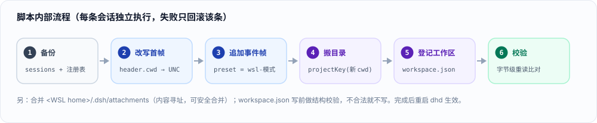
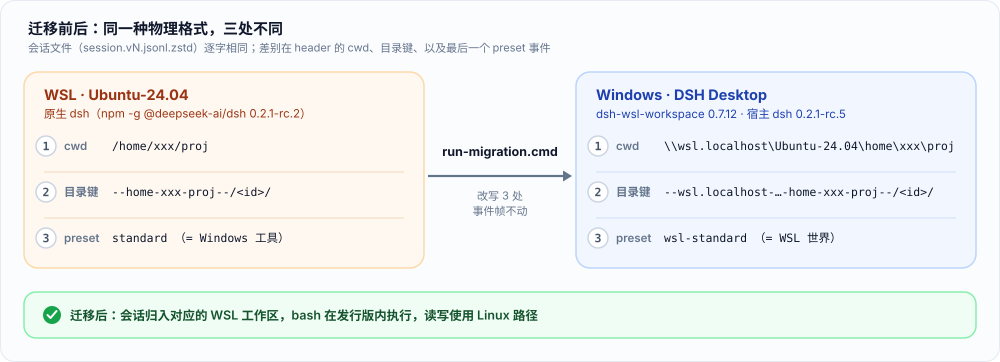

# dsh-session-migration

> 把 **WSL 里原生 `dsh` 的会话**迁进 **Windows 上 DSH Desktop（dhd）的 WSL 工作区**：历史继续可读、可续跑，并且仍然跑在 WSL 里。

| 项 | 值 |
|---|---|
| 方向 | WSL → Windows，**单向**（源库只读，从不修改） |
| 依赖插件 | **`dsh-wsl-workspace`** —— 只验证了它；其他插件不是必需的，其数据也不在迁移范围 |
| 实测环境 | DSH Desktop `0.2.1-rc.5` · `dsh-wsl-workspace` `0.7.12` · WSL 侧 `dsh 0.2.1-rc.2` · Ubuntu 24.04 / Windows 11 |
| 入口 | `run-migration.cmd`（自动使用 dhd 自带的 `node.exe`） |
| 安全性 | 迁移前整份备份 · 每条会话写完即字节级校验 · 支持回滚 |

---

## QuickStart

### ① 先确认能不能用（三条全中）

- [ ] Windows 上跑着 **DSH Desktop**，且装了 **`dsh-wsl-workspace`**、已经把 WSL 目录加成工作区
- [ ] **同一台机器的 WSL 里另有一份原生 `dsh`**，`~/.dsh/sessions` 里有要迁的历史会话
- [ ] 目标就是让这些会话在 dhd 里**继续跑在 WSL 里**（不是只当档案看）

> 缺任何一条都别硬跑 —— 见 **1 · 适用条件** 的「不适用」表。

### ② 三步搞定

```powershell
cd C:\Users\<User>\.dsh\migration

.\run-migration.cmd --dry-run   # ① 看计划，不改任何文件
.\run-migration.cmd             # ② 正式迁移：先备份，再输 yes 确认
# ③ 启动 dhd → Workspaces → 打开对应的 WSL 工作区
```

> 迁移期间 **dhd 必须完全退出**（托盘 → 退出；任务管理器无 `DeepSeek Harness.exe`）。脚本会自己检测，仍在运行会拒绝执行。

### ③ 怎么算成功

侧栏多出 `xxx` / `proj-a` / `proj-b` 等工作区（标题取自目录名） → 打开会话，模式标签是 **`WSL · 标准模式`**，`pwd` 为 `/home/xxx/…`。（细节见 **7 · 迁移后自检**）

---

## 1 · 适用条件

### 1.1 适用 / 不适用

| ✅ 适用 | ❌ 不适用 |
|---|---|
| 同一台机器：Windows 跑 dhd，WSL 里另有一份原生 dsh | 没装 `dsh-wsl-workspace`，或没把 WSL 目录加成工作区 |
| 用插件把 WSL 目录注册成工作区，日常在那里干活 | 反向迁移：Windows dhd 会话 → WSL 上的 dsh |
| 希望历史会话**继续跑在 WSL 里**（不是只当档案看） | 想让两边共用一个会话库（软链 / 共享目录） |
| | 迁移其他插件的数据（皮肤、graph-memory、market、cost-meter…）· 未验证 |
| | 跨机器搬会话库 · 未验证 |

### 1.2 前置检查

| 检查 | 说明 |
|---|---|
| 插件 | `profiles/*/node_modules/dsh-wsl-workspace` 存在；脚本启动横幅会打印版本，缺失时明确告警 |
| 工作区 | dhd 里至少有一个 WSL 工作区（`\\wsl.localhost\<发行版>\…`） |
| WSL | 迁移时 WSL 能启动，UNC 路径可访问（脚本用 `wsl.exe test -d` 逐个检查源目录） |
| dhd | **完全退出**；脚本检测到 `DeepSeek Harness.exe` 会拒绝执行 |
| 运行环境 | Windows；Node ≥ 22.15（`run-migration.cmd` 直接用 dhd 自带的 24.21，无需另装） |

## 2 · 使用方法

### 2.1 每条命令做什么

| 命令 | 做什么 | 会改文件吗 |
|---|---|---|
| `--dry-run` | 逐个列出：会话 id、原 cwd、目标 cwd、目录怎么搬、事件数、preset 怎么变；并标出「已就位 / 冲突 / 不可迁移 / 读不出来」 | 否 |
| 直接运行 | 打印计划 → 等 `yes` → 备份 → 逐条迁移并自校验（失败只回滚该条）→ 合并附件 → 打印结果与回滚命令 | 是（先备份） |
| `--check` | 只看当前状态分类，不做任何事 | 否 |
| `--reconcile` | 只把「已就位但不属于任何工作区」的会话重新登记 | 只改 `workspace.json` |

预期输出：

```text
sessions found : 17
to migrate     : 14
  session-xxxxxxxx-…  format v4  1200+ event(s)  preset standard -> wsl-standard
  …
migrated : 14   failed : 0   workspaces : 3 created, 14 session(s) registered
```

### 2.2 脚本内部流程



### 2.3 出问题先看这里

| 症状 | 命令 |
|---|---|
| 想先看清楚现状 | `.\run-migration.cmd --check` |
| 迁移后某个工作区被我删了，会话不见了 | `.\run-migration.cmd --reconcile --yes`（只重新登记，不移动） |
| 有会话冲突/不可迁移 | `--dry-run` 输出会点名到具体 id 与原因；见 **9 · FAQ** |
| 想撤销 | 见 **8 · 回滚** |

## 3 · 迁移前后



## 4 · 三处差异（为什么需要这个工具）

> 物理格式**完全相同**（`session.vN.jsonl.zstd`，首帧一行 header + 事件帧）。不一致的只有：

| # | 项 | WSL 原生 dsh | dhd + `dsh-wsl-workspace` |
|---|---|---|---|
| 1 | header `cwd` | `/home/xxx/proj` | `\\wsl.localhost\Ubuntu-24.04\home\xxx\proj` |
| 2 | 会话目录 | `--home-xxx-proj--/<id>/` | `--wsl.localhost-Ubuntu-24.04-home-xxx-proj--/<id>/` |
| 3 | 最后一个 `agent-preset/selected` | 没有 → 取创建时的 `standard` | `wsl-standard` / `wsl-ptc` / … |

**直接拷文件会怎样**

| 现象 | 机制 |
|---|---|
| ❌ 归不了位 | dhd 每次读取用 header `cwd` 反推日志目录，不符 → 判 `corrupt` / `duplicate` |
| ❌ 侧栏看不见 | 成员资格 = `realpath(cwd) == workspace.path`；Windows 上 `/home/…` 解析失败 → 静默过滤 |
| ❌ 能开也跑错世界 | `standard` = Windows 工具；已开过回合的会话模式选择器锁死（`agent-preset/locked`） |

## 5 · 兼容性

| 组件 | 实测版本 | 备注 |
|---|---|---|
| DSH Desktop（`app.asar` 内宿主 dsh） | `0.2.1-rc.5` | |
| `dsh-wsl-workspace` | `0.7.12` | 声明兼容表最高到 `0.2.1-rc.2`，**rc.5 未声明但实测可用** |
| WSL 侧原生 `dsh` | `0.2.1-rc.2` | npm 全局安装 |
| 发行版 / 系统 | Ubuntu 24.04 · WSL2 · Windows 11 | |

**脚本依赖的三条内部契约**（先检查；不符就报错或跳过，绝不猜）：

| 契约 | 要求 |
|---|---|
| 会话存储 | `sessions/--<projectKey(cwd)>--/<id>/` + 拼接 zstd 帧，**首帧恰好一行 header**；当前 `v4`，`v1..v3` 只改 cwd、升级交给 dhd |
| 工作区注册表 | `storages/workspace.json`，unit `workspace` **version 2** |
| 执行世界 | 末尾事件必须是 `agent-preset/selected` → `wsl-standard` / `wsl-ptc` / `wsl-minimal` / `wsl-cordis` |

## 6 · 参数

| 参数 | 作用 |
|---|---|
| `--dry-run` | 只打印计划，不改文件 |
| `--check` | 报告每个会话是「该迁移 / 已就位 / 冲突 / 不可迁移」 |
| `--reconcile` | **只**把「已就位但不属于任何工作区」的会话重新登记；不移动、不改写 |
| `--dsh-home <dir>` | dhd 的 DSH home，默认 `%USERPROFILE%\.dsh` |
| `--distro <name>` | WSL 发行版，默认自动识别 |
| `--wsl-home <path>` | WSL 用户 home（如 `/home/xxx`），用于合并附件 |
| `--no-preset` | 不追加 WSL 模式事件（保持原模式，通常是 Windows 工具；一般不用） |
| `--no-attachments` | 不合并 `.dsh/attachments` |
| `--no-backup` | 跳过备份（不建议） |
| `--only <substr>` | 只处理项目目录名/cwd 含该子串的会话 |
| `--yes` / `-y` | 跳过交互确认 |
| `--force` | 检测到 dhd 仍在运行时也继续（仅调试） |

## 7 · 迁移后自检

| 检查点 | 期望 |
|---|---|
| 侧栏 Workspaces | `xxx` · `proj-a` · `proj-b` 各成一个 WSL 工作区 |
| 会话模式标签 | `WSL · 标准模式`（或原模式的 WSL 变体） |
| 会话内 `pwd` | `/home/xxx/…` |
| 事件帧完整性 | 迁移时逐条校验：帧数 = 原帧数 + 1，事件帧字节完全一致 |

本机实测：`14/14` 迁移成功；dhd 启动后按它自己的 `realpath(cwd) == workspace.path` 规则复核 `18/18` 全部匹配；随后直接续跑了一个 4 万+ 事件的会话。

## 8 · 回滚

```text
退出 dhd  →  删 ~/.dsh/sessions  →  还原 sessions.bak-<时间戳>/ 与 workspace.json.bak-<时间戳>  →  启动
```

WSL 侧 `~/.dsh` **从不被修改**，天然是第二份备份。

## 9 · FAQ

| 问题 | 处理 |
|---|---|
| 迁移后又拷了一次旧目录 → `duplicate JSONL session id` | 同一 `sessionId` 出现在两个项目目录；删掉重复拷贝，整目录重跑本脚本（会报 conflict，不覆盖） |
| 删了工作区，会话不见了 | 日志仍在；`.\run-migration.cmd --reconcile --yes` 重新登记 |
| 只有 4 个事件的会话 | 当年点开过没聊天的空会话，可删 |
| `v3` 老会话 | 首次在 dhd 打开时自动升级为 `v4` |
| `isSeeded` 但父会话没拷过来 | 作为独立会话打开/续跑；不再有完整分叉谱系 |
| 凭据 / 模型 / 插件配置 | 不迁（只迁会话）；dhd 用自己 profile 的设置 |
| 插件版本不在声明表里 | 本机 rc.5 实测可用；换版本先 `--dry-run` + 单会话试点 |

## 10 · 目录

```text
.dsh/migration/
├── README.md                      # 本文
├── run-migration.cmd              # 入口：定位 dhd 自带 node.exe 并调用脚本
├── migrate-dsh-wsl-sessions.mjs   # 迁移脚本（零第三方依赖）
└── diagrams/
    ├── flow.svg                   # 迁移前后对照（README 引用 SVG）
    ├── flow.png                   # 同图 2x 位图，供不渲染 SVG 的场合
    ├── pipeline.svg               # 脚本内部流程
    └── pipeline.png
```

## 免责

自用工具：直接改写你自己的会话库（有备份、写后即校验、失败即清理该条）。跨版本、跨机器、或其他插件提供 WSL 世界的场景未验证，请先 `--dry-run` 与试点。
